<h1 align="center">Dhruv Diwakirti ❤️‍🔥</h1>

<p align="center">
  <a href="https://www.linkedin.com/in/dhruvdiwa/">LinkedIn</a>
  &nbsp;·&nbsp;
  <a href="mailto:loltreat1@gmail.com">Email</a>
</p>

## About me

_**AI Intern @ATLYS ✈︎**_ 

Plumbing My Way Around AI-Native Systems.🚢


<p align="center">
  
  <br />
  <sub><i>plate 01 · 0 GPUs, 0 lines of JS — one hand-rolled .svg: feTurbulence noise, a displacement map and SMIL</i></sub>
</p>

<details>
<summary><code>$ cat fun.png | braille</code> <sub>— for the terminal purists</sub></summary>

```text
⠁⠀⠁⠀⠁⠀⠁⠀⠁⠀⠁⠀⠁⠀⠁⠀⠁⠀⠁⠀⠁⠀⠁⠀⠁⠀⠁⠀⠁⠀⠁⠀⠁⠀⠁⠀⠁⠀⠁⠀⠁⠀⠁⠀⠁⠀⠁⠀⠁⠀⠁⠀⠁⠀⠁⠀⠁⠀⠁
⠁⠀⠁⠀⠁⠀⠁⠀⠁⠀⠁⠀⠁⠀⠁⠀⠁⠀⠁⠀⠁⠀⠁⠀⠁⠀⠁⠀⠁⠀⠁⠀⠁⠀⠁⢀⢁⣄⢁⣄⢁⠀⠁⠀⠁⠀⠁⠀⠁⠀⠁⠀⠁⠀⠁⠀⠁⠀⠁
⠁⠀⠁⠀⠁⠀⠁⠀⠁⠀⠁⠀⠁⠀⠁⠀⠁⠀⠁⠀⠁⠀⠁⠀⠁⠀⠁⠀⠁⠀⠁⢀⣷⣿⣿⣿⣿⣿⣿⣿⣿⣿⢷⣦⣁⠄⠁⠀⠁⠀⠁⠀⠁⠀⠁⠀⠁⠀⠁
⠁⠀⠁⠀⠁⠀⠁⠀⠁⠀⠁⠀⠁⠀⠁⠀⠁⠀⠁⠀⠁⠀⠁⠀⠁⠀⠁⠀⠁⢀⢡⣼⢿⢿⠝⢽⣿⢿⠟⢽⢿⣿⣿⣿⣿⣿⢷⣤⢁⠀⠁⠀⠁⠀⠁⠀⠁⠀⠁
⠁⠀⠁⠀⠁⠀⠁⠀⠁⠀⠁⠀⠁⠀⠁⠀⠁⠀⠁⠀⠁⠀⠁⠀⠁⠀⠁⠀⠁⢼⠿⢽⢿⠅⠁⠝⠉⣅⢅⣵⣿⣿⣿⣿⣿⣿⣿⣿⠿⠀⠁⠀⠁⠀⠁⠀⠁⠀⠁
⠁⠀⠁⠀⠁⠀⠁⠀⠁⠀⠁⠀⠁⠀⠁⠀⠁⠀⠁⠀⠁⠀⠁⠀⠁⠀⠁⠀⠽⢍⠕⢕⠅⠅⠁⠀⠑⠅⢽⣿⣿⣿⣿⣿⣿⣿⠿⠿⠃⠀⠁⠀⠁⠀⠁⠀⠁⠀⠁
⠁⠀⠁⠀⠁⠀⠁⠀⠁⠀⠁⠀⠁⠀⠁⠀⠁⠀⠁⠀⠁⠀⠁⠀⠁⠀⠁⠀⠁⠀⠁⠅⠁⠁⠁⠄⠁⠀⠅⢽⣿⣿⣿⣿⢿⠟⠁⠀⠁⢀⢁⣤⢥⣴⢵⢄⠁⠀⠁
⠁⠀⠁⠀⠁⠀⠁⠀⠁⠀⠁⠀⠁⠀⠁⠀⠁⠀⠁⠀⠁⠀⠁⠀⠁⠀⠁⠀⠁⠀⠁⠀⠁⠀⠁⠄⠕⢔⢕⣽⣿⣿⣿⣿⣷⣶⣿⣿⢿⣿⢿⣿⢿⣿⢿⣽⢥⠄⠁
⠁⠀⠁⠀⠁⠀⠁⠀⠁⠀⠁⠀⠁⠀⠁⠀⠁⠀⠁⠀⠁⠀⠁⠀⠁⠀⠁⠀⠁⠀⠁⠀⠁⢄⠀⢅⢵⢽⢿⣿⣿⣿⣿⣿⣿⣿⣿⣿⢿⣿⣿⣿⣿⣿⢿⣿⢿⣽⢧⢄
⠁⠀⠁⠀⠁⠀⠁⠀⠁⠀⠁⠀⠁⠀⠁⠀⠁⠀⠁⠀⠁⠀⠁⠀⠁⠀⠁⠀⠁⠀⠁⠀⠁⢼⢕⢽⢿⣽⢿⣿⢿⣿⢿⣿⢿⣿⣿⣿⢿⣿⣿⣿⣿⣿⣿⣿⢽⣽⢿⣽
⠁⠀⠁⠀⠁⠀⠁⠀⠁⠀⠁⠀⠁⠀⠁⠀⠁⠀⠁⠀⠁⠀⠁⠀⠁⠀⠁⠀⠁⠀⠁⠀⠁⢸⢿⣽⢿⣿⢿⣿⢿⣽⠟⢽⢿⣿⣿⣿⣿⣿⣿⣿⣿⣿⢿⣽⢽⣽⢿⣽
⠁⠀⠁⠀⠁⠀⠁⠀⠁⠀⠁⠀⠁⠀⠁⠀⠁⠀⠁⠀⠁⠀⠁⠀⠁⠀⠁⠀⠁⠀⠁⢀⢵⢽⢽⢽⢿⣽⢿⢽⢿⣽⢵⣵⣿⣿⢿⣿⣿⣿⣿⣿⣿⣽⢿⣿⢿⣿⣿⣿
⠁⠀⠁⠀⠁⠀⠁⠀⠁⠀⠁⠀⠁⠀⠁⠀⠁⠀⠁⠀⠁⠀⠁⠀⠁⠀⠁⠀⠁⢠⢝⢽⢽⣽⢿⣽⢿⣿⣿⣿⣿⣿⣿⣿⣿⣿⣿⣿⣿⣿⣿⣿⢿⣽⢿⣿⢿⣿⣿⣽
⠁⠀⠁⠀⠁⠀⠁⠀⠁⠀⠁⠀⠁⠀⠁⠀⠁⠀⠁⠀⠁⠀⠁⠀⠁⠀⢁⢤⢽⣽⢿⣿⣿⣿⢿⣽⣿⣿⣿⣿⢿⣿⣿⣿⣿⣿⣿⣿⣿⣿⣿⣿⣿⣿⣿⣿⢿⣿⣿⣿
⠁⠀⠁⠀⠁⠀⠁⠀⠁⠀⠁⠀⠁⠀⠁⠀⠁⠀⠁⠀⠁⠀⠁⠀⠁⢸⢽⢽⢿⣽⢿⣿⢿⣿⣿⣿⣿⣿⣿⣿⣿⣿⣿⣿⣿⣿⣿⣿⣿⣿⣿⣿⣿⣿⣿⣿⢿⣽⣿⣿
⠁⠀⠁⠀⠁⠀⠁⠀⠁⠀⠁⠀⠁⠀⠁⠀⠁⠀⠁⠀⠁⠀⠁⠀⠁⢰⢽⣿⢿⣿⢿⣿⢿⣿⣿⣿⢿⣿⢿⣿⣿⣿⣿⣿⣿⣿⣿⣿⣿⣿⣿⣿⣿⣿⣿⣿⣿⣿⢿⣿
⠁⠀⠁⠀⠁⠀⠁⠀⠁⠀⠁⠀⠁⠀⠁⠀⠁⠀⠁⠀⠁⠀⠁⠀⠁⢼⢽⢿⣿⣿⢿⣿⢿⣿⣿⣿⣿⣿⣿⣿⣿⣿⣿⣿⣿⣿⣿⣿⣿⣿⣿⣿⣿⣿⣿⣿⣿⣿⢿⣿
⠀⠀⠀⠀⠀⠀⠀⠀⠀⠀⠀⠀⠀⠀⠀⠀⠀⠀⠀⠀⠀⠀⠀⠀⠀⢑⢽⣽⢿⣿⢿⣿⣿⣿⢿⣿⣿⣿⢿⣿⣿⣿⣿⣿⣿⣿⣿⣿⣿⣿⣿⣿⣿⣿⣿⣿⣿⣿⢿⣿
⠀⠄⠀⠄⠀⠄⠀⠄⠀⠄⠀⠀⠀⠄⠀⠄⠀⠄⠀⠄⠀⠄⠀⠄⠀⢔⢽⢽⢿⣿⢿⣿⢿⣿⢿⣿⢿⢿⢿⣿⢿⣿⢿⣿⢿⣿⣿⣿⣿⣿⢿⣿⢿⣿⢿⣿⢿⣿⢿⢿
```

</details>

<!-- you read raw markdown for fun. we should talk. -->

## Currently

Hunting for SWE / AI engineering internships. Real products, people who ship.
